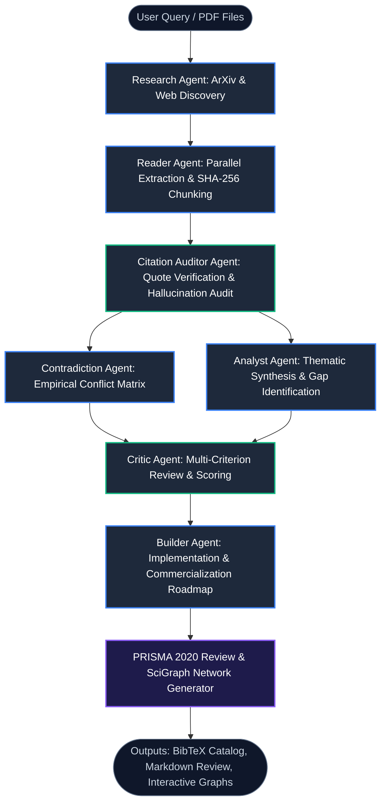

<div align="center">

# 🧠 Autonomous Multi-Agent Research Assistant

### *Production-Grade Asynchronous Literature Review, Empirical Synthesis & Evidence Graph Platform*

[](LICENSE)
[](https://www.python.org/)
[](https://fastapi.tiangolo.com/)
[](https://nextjs.org/)
[](https://www.typescriptlang.org/)
[](docker-compose.yml)
[](#-testing--quality-assurance)
[](audit/10_REMEDIATION_REPORT.md)
[](CONTRIBUTING.md)

<p align="center">
  <a href="#-key-capabilities">Key Features</a> •
  <a href="#-multi-agent-dag-architecture">Architecture</a> •
  <a href="#-security-architecture--remediation">Security</a> •
  <a href="#-quick-start">Quick Start</a> •
  <a href="#-api--websocket-reference">API Reference</a> •
  <a href="#-testing--quality-assurance">Testing</a> •
  <a href="#-contributing">Contributing</a>
</p>

</div>

---

## 📖 Overview

The **Autonomous Multi-Agent Research Assistant** is an end-to-end, full-stack AI platform designed to automate rigorous academic literature reviews, empirical synthesis, and scientific knowledge mapping. 

Rather than relying on linear chains or single-prompt LLM wrappers, the platform executes an asynchronous **Directed Acyclic Graph (DAG)** of **specialized cooperating agents**. The system searches academic repositories (arXiv, Semantic Scholar, DuckDuckGo), ingests uploaded PDFs with deterministic SHA-256 chunk grounding, extracts empirical metrics, evaluates corpus sufficiency through an adaptive feedback loop, constructs cross-paper contradiction matrices, validates claims with fuzzy citation auditing, and synthesizes publication-ready reviews compliant with the **PRISMA 2020 systematic review standard**.

---

## ✨ Key Capabilities

- **⚡ Async Directed Acyclic Graph (DAG) Engine**: Topological dependency resolution, non-blocking asynchronous execution, cycle detection, automatic exponential backoff retries, and bounded concurrency (`asyncio.Semaphore`).
- **🔄 Dynamic Research Sufficiency Loop**: Adaptive feedback evaluation that monitors corpus breadth, evidence density, and research gap coverage, intelligently querying targeted papers when additional depth is required.
- **🤖 Specialized Autonomous Agents**: Role-specialized agents for academic discovery, deep document extraction, citation auditing, contradiction detection, thematic synthesis, multi-criterion critique, and engineering implementation planning.
- **🛡️ Source-Grounded Security Architecture**: Multi-tenant BOLA session isolation, strict SSRF defense policies blocking cloud metadata/private IPs, indirect prompt injection neutralization, in-memory sliding-window rate limiting, and safe local Next.js Mermaid bundling.
- **🔍 Academic Ingestion & Search**: Dual discovery pipeline querying arXiv and live web sources, combined with multi-page bounded PDF parsing offloaded via `asyncio.to_thread`.
- **🛡️ Strict Citation Grounding**: Deterministic sentence-level SHA-256 chunk hashing and fuzzy Levenshtein sequence matching to prevent hallucinated citations and ungrounded claims.
- **⚔️ Cross-Paper Contradiction Matrix**: Builds an $N \times N$ empirical tension matrix detecting discrepancies across benchmarks, numerical results, and opposing methodologies.
- **📊 PRISMA 2020 Review & Evidence Graph**: Generates automated PRISMA 4-stage systematic review flowcharts and typed SciGraph-style interactive evidence networks.
- **🌊 Real-Time WebSocket Streaming**: Bi-directional event stream transmitting live DAG state transitions (`pending` → `running` → `completed`), progress meters, token logs, and CSWSH origin security validation.
- **📑 Academic Export Suite**: 1-click export of publication-ready BibTeX catalogs (`.bib`) and structured Markdown literature reviews.
- **🎨 Glassmorphic Solar-Prism UI**: Modern Next.js 16 + Tailwind CSS dashboard featuring live agent reasoning logs, interactive tabs, and client-side bundled Mermaid.js visualization.

---

## 🏗️ Multi-Agent DAG Architecture



### Specialized Agent Personas

| Agent | Responsibility | Core Technique | Key Deliverable |
|---|---|---|---|
| **Research Agent** | Academic query expansion & literature discovery | Multi-query expansion, arXiv API, DuckDuckGo search, semantic deduplication | Structured list of relevant papers with metadata |
| **Reader Agent** | Deep document parsing & structural analysis | Section segmentation (`Abstract`, `Methodology`, `Findings`), sentence-level SHA-256 chunking | Normalized paper representations with hash indexes |
| **Citation Auditor** | Grounding verification & hallucination rejection | Fuzzy Levenshtein sequence matching against source chunk hash registry | Verified claim registry, ungrounded claim rejection log |
| **Contradiction Agent** | Empirical dispute & tension detection | $N \times N$ cross-paper pairwise comparison, numerical range divergence analysis | Empirical Contradiction Matrix with tension scores |
| **Analyst Agent** | Thematic synthesis & meta-analysis | Cross-paper consensus mapping, paradigm shift identification, research gap detection | Comprehensive thematic synthesis report |
| **Critic Agent** | Rigorous peer review & quality audit | 4-axis grading (*Methodology*, *Grounding*, *Novelty*, *Clarity*) | Numerical quality scores & critical appraisal |
| **Builder Agent** | Engineering & commercial translation | 4-phase development roadmap, technical stack selection, risk mitigation | Actionable engineering implementation plan |

---

## 📁 Repository Structure

```
Multi_agent_research_assistant/
├── .github/
│   ├── ISSUE_TEMPLATE/
│   │   ├── bug_report.md
│   │   └── feature_request.md
│   ├── pull_request_template.md
│   └── workflows/
│       └── ci.yml               # Automated CI (Tests, Ruff Lint, TypeScript check)
├── backend/
│   ├── agents/                  # 7 Specialized Agent implementations
│   │   ├── analyst_agent.py
│   │   ├── builder_agent.py
│   │   ├── citation_auditor.py
│   │   ├── contradiction_agent.py
│   │   ├── critic_agent.py
│   │   ├── orchestrator.py      # DAG execution orchestrator
│   │   ├── reader_agent.py
│   │   └── research_agent.py
│   ├── api/                     # FastAPI route handlers & WebSocket endpoints
│   │   ├── routes/
│   │   │   ├── health.py
│   │   │   ├── research.py
│   │   │   └── websocket.py
│   │   └── main.py
│   ├── core/                    # Computational engines
│   │   ├── citation_grounding.py
│   │   ├── contradiction_matrix.py
│   │   ├── dag_engine.py        # Asynchronous DAG execution engine
│   │   ├── evidence_graph.py    # SciGraph knowledge network generator
│   │   ├── llm.py              # LLM client abstractions (Ollama, heuristic)
│   │   └── prisma_review.py     # PRISMA 2020 4-stage systematic review audit
│   ├── models/
│   │   └── schemas.py           # Pydantic v2 domain models & schemas
│   ├── services/                # External services & exporters
│   │   ├── academic_exporter.py # BibTeX & Markdown export generation
│   │   ├── arxiv_service.py
│   │   ├── pdf_service.py
│   │   └── semantic_scholar_service.py
│   ├── storage/
│   │   └── session_store.py     # Path-traversal-hardened atomic session persistence
│   ├── tests/                   # 44 Offline unit & integration tests
│   └── requirements.txt
├── frontend/
│   ├── src/
│   │   ├── app/                 # Next.js App Router (layout, globals.css, page)
│   │   ├── components/
│   │   │   ├── dashboard/       # Specialized dashboard panels (Timeline, Dropper, Tabs)
│   │   │   ├── ui/              # Button, Card, Input, MermaidViewer
│   │   │   └── research-dashboard.tsx
│   │   └── lib/                 # API client, WebSocket client, TypeScript interfaces
│   ├── package.json
│   └── tsconfig.json
├── docker-compose.yml           # Multi-container orchestration
├── Dockerfile.backend           # Production multi-stage Python container
├── Dockerfile.frontend          # Production multi-stage Next.js container
├── start.bat                    # 1-Click Windows launcher
├── start.sh                     # 1-Click Linux/macOS launcher
├── .env.example                 # Environment configuration template
├── CONTRIBUTING.md              # Contribution guidelines
├── LICENSE                      # MIT License
└── CITATION.cff                 # Academic citation metadata
```

---

## ⚡ Quick Start

### Option A: Docker Compose (Recommended)

Run both frontend and backend in isolated, production-grade containers:

```bash
docker compose up --build
```

- **Frontend Dashboard**: [http://localhost:3000](http://localhost:3000)
- **Backend Swagger API Docs**: [http://localhost:8000/docs](http://localhost:8000/docs)
- **Health Check**: [http://localhost:8000/api/v1/health](http://localhost:8000/api/v1/health)

---

### Option B: 1-Click Scripts

- **Windows**:
  ```cmd
  start.bat
  ```
- **Linux / macOS**:
  ```bash
  chmod +x start.sh
  ./start.sh
  ```

---

### Option C: Manual Local Setup

#### 1. Prerequisites
- Python 3.11+
- Node.js 20+ & npm

#### 2. Backend Setup
```bash
# Clone the repository
git clone https://github.com/tushar152006/Multi_agent_research_assistant.git
cd Multi_agent_research_assistant

# Create and activate virtual environment
python -m venv .venv
# Windows:
.venv\Scripts\activate
# Linux/macOS:
source .venv/bin/activate

# Install dependencies
pip install -r backend/requirements.txt

# Start backend server
uvicorn backend.api.main:app --reload --host 127.0.0.1 --port 8000
```

#### 3. Frontend Setup
In a separate terminal:
```bash
cd frontend

# Install Node dependencies
npm install

# Start Next.js development server
npm run dev
```
Open **[http://localhost:3000](http://localhost:3000)** in your browser.

---

## ⚙️ Configuration & Environment

Copy `.env.example` to create your local `.env`:

```bash
cp .env.example .env
```

| Variable | Default | Description |
|---|---|---|
| `APP_NAME` | `Multi-Agent Research Assistant` | Application display name |
| `ENVIRONMENT` | `development` | Runtime environment (`development`, `production`) |
| `LOG_LEVEL` | `INFO` | Logging verbosity (`DEBUG`, `INFO`, `WARNING`, `ERROR`) |
| `ALLOWED_ORIGINS` | `http://localhost:3000,...` | Comma-separated or list of allowed CORS & CSWSH origins |
| `AUTH_REQUIRED` | `false` | Set to `true` to require Bearer tokens or `X-User-ID` |
| `LLM_PROVIDER` | `groq` | LLM backend engine: `groq`, `heuristic`, `ollama`, or `openai` |
| `GROQ_API_KEY` | *None (required if groq)* | Free Groq API key from console.groq.com |
| `GROQ_MODEL` | `openai/gpt-oss-120b` | High-capacity fast reasoning model on Groq |
| `OLLAMA_BASE_URL`| `http://localhost:11434` | Ollama service endpoint URL |
| `OLLAMA_MODEL` | `llama3.1:8b` | Model name for local LLM inference |
| `SEMANTIC_SCHOLAR_API_KEY` | *None (optional)* | API key for higher Semantic Scholar rate limits |
| `LOCAL_STORAGE_PATH` | `backend/data` | Root path for session persistence |

> [!TIP]
> Never commit your real API keys to version control. Keep them safely stored in your local `.env` file, which is ignored by `.gitignore`.

---

## 🛡️ Security Architecture & Invariant Enforcement

This platform has completed a source-grounded security audit and adversarial verification ([`audit/10_REMEDIATION_REPORT.md`](audit/10_REMEDIATION_REPORT.md)). All 10 core security invariants are enforced and tested:

1. **BOLA & Multi-Tenant Session Isolation**: Sessions are isolated per user in `backend/data/sessions/{user_id}/{session_id}.json` with strict alphanumeric path validation. Cross-tenant access, exports, and deletions return HTTP 404.
2. **Strict SSRF Defense Engine**: Outbound PDF fetching validates IP addresses against RFC1918 private subnets, loopbacks, link-local, and cloud metadata (`169.254.169.254`), with a 4-hop redirect re-validation loop.
3. **Safe Bundled Mermaid Visualizations**: Dynamic `new Function(...)` CDN evaluation has been replaced by a locally bundled `mermaid` package in Next.js, with `securityLevel: "strict"` and SVG markup sanitization.
4. **WebSocket CSWSH & CORS Hardening**: WebSocket connections validate the HTTP `Origin` header against permitted domains (rejecting unauthorized origins with code `1008`) and isolate sessions per tenant.
5. **PDF Resource Exhaustion Protection**: Enforces a 100-page limit and 20MB file cap, offloading CPU-intensive parsing to worker threads via `asyncio.to_thread`.
6. **Indirect Prompt Injection Neutralization**: Delimiters (`<untrusted_research_data>`) and LLM instruction control tokens are sanitized across all 5 agent prompts.
7. **In-Memory Sliding-Window Rate Limiting**: Expensive multi-agent DAG requests are protected with 20 requests/minute per client, emitting HTTP 429 with `Retry-After`.
8. **Container Security**: Non-root system users (`USER appuser` in backend, `USER node` in frontend).
9. **Defense-in-Depth HTTP Headers**: `X-Content-Type-Options: nosniff`, `X-Frame-Options: DENY`, and `Referrer-Policy: strict-origin-when-cross-origin`.
10. **Sanitized Production Errors**: Internal stack traces and file paths are suppressed in production mode.

---

## 🔌 API & WebSocket Reference

### REST Endpoints

| Method | Endpoint | Description |
|---|---|---|
| `GET` | `/api/v1/health` | Service health status and uptime |
| `POST` | `/api/v1/research` | Trigger research workflow with query or uploaded papers |
| `POST` | `/api/v1/research/upload-pdf` | Upload and extract content from research PDF documents |
| `GET` | `/api/v1/research/{session_id}` | Retrieve complete research session state and artifacts |
| `DELETE`| `/api/v1/research/{session_id}` | Delete session (scoped strictly to authenticated tenant) |
| `GET` | `/api/v1/research/{session_id}/export/bibtex` | Download publication-ready BibTeX `.bib` reference catalog |
| `GET` | `/api/v1/research/{session_id}/export/markdown` | Download complete systematic literature review in Markdown |

### WebSocket Real-Time Protocol (`/ws/research`)

Connect via WebSocket to stream live execution progress:
```javascript
const socket = new WebSocket('ws://localhost:8000/ws/research?user_id=researcher_1');

// Start research workflow
socket.send(JSON.stringify({
  action: "start",
  query: "Emergent reasoning capabilities in sparse mixture-of-experts architectures"
}));

// Receive real-time DAG events
socket.onmessage = (event) => {
  const data = JSON.parse(event.data);
  console.log(`[${data.type}]`, data.payload);
};
```

#### Supported WebSocket Event Types:
- `dag_node_update`: Status transition for a DAG agent node (`pending` | `running` | `completed` | `failed`)
- `progress`: Overall workflow percentage completion and active step summary
- `log`: Streaming agent reasoning logs and ingestion metrics
- `result`: Final assembled research payload with all artifacts
- `error`: Structured exception notifications

---

## 🧪 Testing & Quality Assurance

The test suite runs **100% offline** with zero external network or API dependencies:

```bash
# Run complete backend test suite (69 tests)
.venv\Scripts\python -m unittest discover -s backend/tests -p "test_*.py"
```

```
.....................................................................
----------------------------------------------------------------------
Ran 69 tests in ~65s

OK
```

### Verified Test Suites:
- **`test_security.py`** (15 tests): BOLA multi-tenancy, SSRF blocking, CSWSH rejection, rate limiting, PDF bounds, prompt injection sanitization.
- **`test_golden_benchmark.py`**: End-to-end golden verification of PRISMA synthesis, citation grounding precision, and adaptive loop termination.
- **`test_research_sufficiency.py`**: Evaluation of research breadth, evidence density, and research gap coverage.
- **`test_dag_engine.py`**: Topological sort, cycle detection, failure isolation, retry policies.
- **`test_citation_grounding.py`**: Sentence-level chunk hashing, Levenshtein matching, hallucination auditing.
- **`test_contradiction_matrix.py`**: Pairwise conflict evaluation, metric divergence, tension scoring.
- **`test_prisma_evidence_graph.py`**: PRISMA 2020 4-stage review criteria, SciGraph typed evidence networks.
- **`test_academic_exporter.py`**: BibTeX schema formatting, Markdown synthesis export validation.
- **`test_session_store.py`**: Multi-tenant session persistence, path traversal security constraints.
- **`test_pdf_upload.py`**: Multipart binary PDF handling and section extraction.

### Frontend Verification:
```bash
cd frontend
npx tsc --noEmit    # Static TypeScript type check
npm run build       # Next.js Turbopack production compilation
```

---

## 🤝 Contributing

Contributions are welcome! Please read [CONTRIBUTING.md](CONTRIBUTING.md) for details on our code of conduct, development setup, and pull request guidelines.

1. Fork the repository
2. Create your feature branch (`git checkout -b feat/amazing-feature`)
3. Commit your changes (`git commit -m 'feat: Add amazing feature'`)
4. Push to the branch (`git push origin feat/amazing-feature`)
5. Open a Pull Request

---

## 📜 Citation

If you use this project in academic research or software development, please cite it:

```bibtex
@software{multi_agent_research_assistant_2026,
  author = {Tushar},
  title = {Autonomous Multi-Agent Research Assistant: Asynchronous DAG Literature Review Platform},
  year = {2026},
  url = {https://github.com/tushar152006/Multi_agent_research_assistant}
}
```

---

## 📄 License

Distributed under the **MIT License**. See [`LICENSE`](LICENSE) for more details.